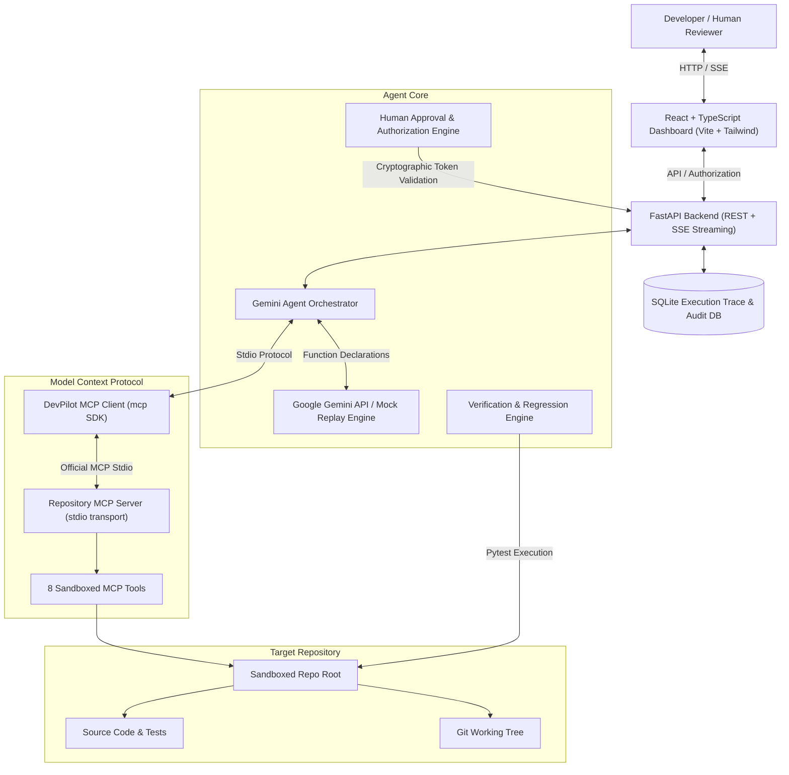
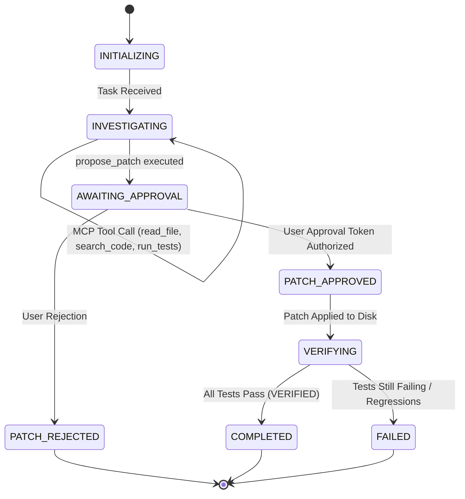

# DevPilot System Architecture & Protocol Specification

DevPilot is an AI-Native Software Engineering Agent that bridges the **Official Model Context Protocol (MCP)** with **Google Gemini Developer API** and an explicit **Human-in-the-Loop Governance Model**.

---

## 1. High-Level Architecture

---

## 2. Component Breakdown

### A. Gemini Agent Orchestrator
- Discovers tools from the MCP server dynamically at startup via `session.list_tools()`.
- Converts MCP JSON schemas to `google.genai.types.FunctionDeclaration` objects.
- Executes multi-turn investigation loops:
  1. Establishes baseline failure by calling `run_tests`.
  2. Searches code symbols and inspects failing files.
  3. Diagnoses root causes and formulates unified diffs.
  4. Proposes patches via `propose_patch` and immediately halts execution at `AWAITING_APPROVAL`.
- Produces structured, evidence-backed engineering reports upon verified resolution.

### B. Genuine MCP Client & Server
- Implemented using the official Python `mcp` SDK (`mcp.client.session.ClientSession`, `mcp.client.stdio.stdio_client`, `mcp.server.mcpserver.MCPServer`).
- Operates over standard I/O (`stdio` transport) via subprocess management.
- Does not simulate or fake MCP: tools are registered as true MCP tools, typed using Pydantic, and returned over standard protocol streams.

### C. Human-in-the-Loop Authorization Engine
- **Core Principle:** Safety cannot rely purely on prompting the LLM.
- Proposing a patch assigns a SHA-256 cryptographic `approval_token` and marks status `PENDING_APPROVAL`.
- The backend authorization logic rejects any file write if the approval token is invalid, missing, or if the patch status is not `PENDING_APPROVAL`.
- Approvals can only be authorized by human operators via the UI or `POST /api/sessions/{session_id}/patches/{patch_id}/approve`.

### D. Verification Engine
- **Core Invariant:** *A generated patch is not equivalent to a verified fix.*
- Runs automated pytest suites before patch proposal (`BASELINE`) and after patch application (`VERIFICATION`).
- Compares failure node IDs between runs:
  - Confirms baseline failures transitioned to `PASSED`.
  - Verifies zero regressions introduced.
  - Checks clean exit code (0).

### E. SQLite Execution Trace
Maintains a thread-safe audit trail:
- `sessions`: Session state, tasks, timestamps.
- `agent_plans`: Step-by-step progress tracking.
- `tool_calls`: Tool names, execution time, redacted parameters, structured output.
- `patches`: Proposed diffs, rationales, approval tokens, decision outcomes.
- `test_runs`: Pass/fail metrics, exit codes, failure tracebacks.
- `reports`: Generated markdown reports with verification status.

---

## 3. Investigation State Machine

