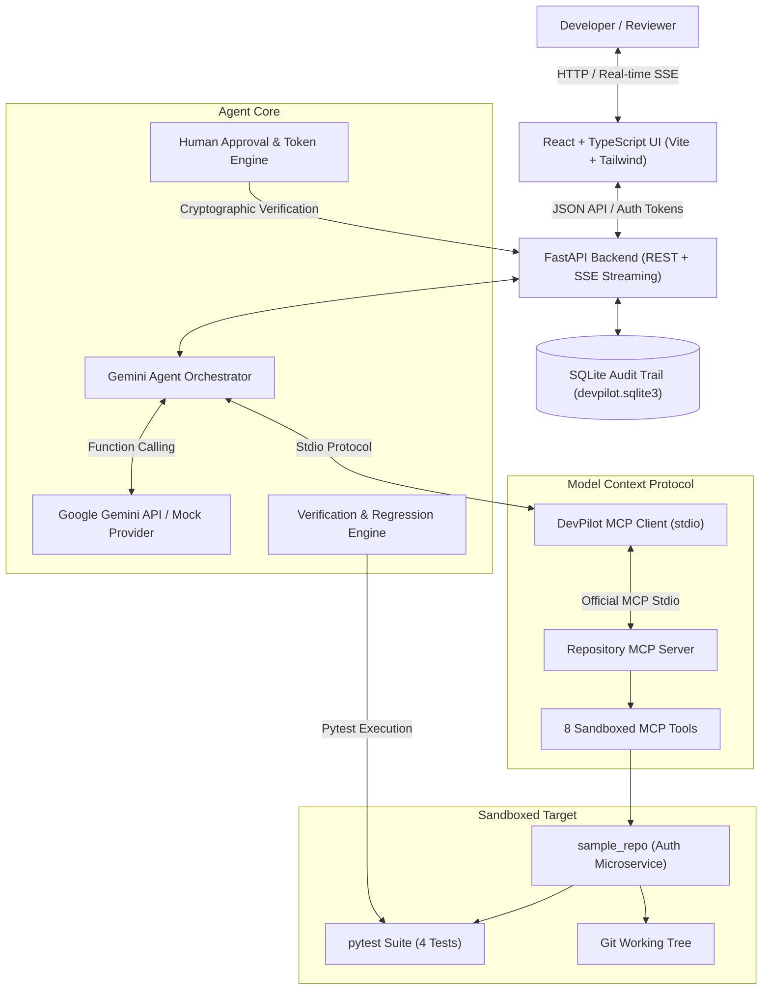

# DevPilot 🚀

> **Production-Style MCP Software Engineering Agent with Verifiable Human-in-the-Loop Governance**  
> *Autonomous code investigation, test failure diagnosis, human-approved patching, and regression verification.*

[](https://www.python.org/downloads/)
[](https://modelcontextprotocol.io/)
[](https://fastapi.tiangolo.com)
[](https://react.dev)
[](TESTING.md)
[](https://devpilot-mcp-agent.vercel.app)
[](LICENSE)

---

## 1. Problem Statement

Modern AI coding assistants often operate as unconstrained code generators or simulate tool usage through ad-hoc function-calling wrappers. In enterprise software engineering environments:
1. **Unconstrained Execution is Dangerous:** Allowing an LLM unrestricted shell or filesystem access creates severe security vulnerabilities, data corruption risks, and supply-chain leakage.
2. **Hallucination Without Verification:** A patch generated by an LLM is frequently assumed to work without running regressions, causing silent breakages.
3. **Lack of Protocol Standardization:** Without an open, interoperable standard, integrating agentic tools with diverse codebases and IDEs is fragmented.

**DevPilot** addresses these challenges by implementing an autonomous software engineering assistant built on the **Official Model Context Protocol (MCP)** and **Google Gemini Developer API**. DevPilot inspects repositories, runs tests, isolates root causes, proposes structured unified diffs, halts for explicit human approval via cryptographic authorization tokens, and validates solutions through its verification engine.

---

## 2. Core Features

- 🔌 **Genuine Model Context Protocol (MCP):** Connects to a dedicated repository MCP server over `stdio` transport using the official `mcp` Python SDK.
- 🛠️ **8 Sandboxed MCP Tools:**
  1. `inspect_repository`
  2. `list_files`
  3. `read_file`
  4. `search_code`
  5. `run_tests`
  6. `get_git_status`
  7. `get_git_diff`
  8. `propose_patch`
- 🛡️ **Backend-Enforced Human Approval Gate:** Write operations cannot bypass approval. Proposing a patch issues a SHA-256 token and sets status to `PENDING_APPROVAL`. Source files remain untouched until explicitly approved.
- 🧪 **Verification & Regression Engine:** Enforces the invariant: *A generated patch is not equivalent to a verified fix.* Executes baseline and post-patch pytest runs, validating zero regressions.
- 📊 **SQLite Execution Trace & Audit Trail:** Persists all plans, tool invocations, redacted parameters, approval decisions, test outputs, and final engineering reports.
- 🎨 **Modern Developer Dashboard:** Minimal, responsive web interface built with React 19, TypeScript, Vite, and Tailwind CSS.
- 🔒 **Defense-in-Depth Security:** Path traversal protection (`commonpath` checks), command allowlisting, subprocess timeouts, and secret redaction.
- ⚡ **Offline-Ready Deterministic Replay:** Includes a deterministic mock provider enabling 100% of the unit, integration, and E2E test suites to pass offline without requiring API keys.

---

## 3. Architecture Overview



Detailed technical specifications are documented in [ARCHITECTURE.md](ARCHITECTURE.md) and [MCP_TOOLS.md](MCP_TOOLS.md).

---

## 4. Model Context Protocol (MCP) Integration

DevPilot uses the official Model Context Protocol (MCP v2.x):
1. **Server Initialization (`devpilot.mcp_server.server`):** Registers 8 tools using `@server.tool()`, complete with typed Pydantic input models and structured JSON outputs.
2. **Client Session Handshake (`devpilot.mcp_client.client`):** Establishes an asynchronous `ClientSession` over `stdio_client`, executing the standard MCP protocol handshake.
3. **Dynamic Discovery:** Discovers tools dynamically at runtime via `session.list_tools()`.
4. **Schema Translation:** Automatically converts MCP JSON Schema definitions into Gemini `types.FunctionDeclaration` objects.

```python
# MCP Client Connection Example
from mcp.client.stdio import StdioServerParameters, stdio_client
from mcp.client.session import ClientSession

server_params = StdioServerParameters(
    command="python",
    args=["-m", "devpilot.mcp_server.server", "--repo-root", "/path/to/repo"],
)
async with stdio_client(server_params) as (read, write):
    async with ClientSession(read, write) as session:
        await session.initialize()
        tools = await session.list_tools()
        result = await session.call_tool("run_tests", {"command": "pytest -v"})
```

---

## 5. Quickstart & Setup

### Prerequisites
- Python 3.11+
- Node.js 20+ & npm
- Git

### 1. Clone the Repository
```bash
git clone https://github.com/AdvythVaman05/devpilot-mcp-agent.git
cd devpilot-mcp-agent
```

### 2. Configure Backend Virtual Environment
```bash
python -m venv .venv

# On Linux/macOS:
source .venv/bin/activate

# On Windows:
.\.venv\Scripts\activate

# Install Python dependencies
pip install -r requirements.txt
```

### 3. Build Frontend Dashboard
```bash
cd frontend
npm install
npm run build
cd ..
```

### 4. Configure Environment (Optional)
```bash
cp .env.example .env
# DevPilot works out-of-the-box with its offline deterministic engine!
# To use live Google Gemini models, set your API key:
# GEMINI_API_KEY=your_gemini_api_key_here
```

### 5. Launch DevPilot Server
```bash
python -m devpilot.main --host 0.0.0.0 --port 8000
```
Open **[http://localhost:8000](http://localhost:8000)** in your browser to access the dashboard.

---

## 6. Example Execution Walkthrough

DevPilot comes with a realistic sample microservice repository in `sample_repo/`:
- **Repository:** An HMAC-SHA256 JWT authentication service with user roles.
- **Intentional Bug (`auth_service/auth.py` line 88):**
  ```python
  # Inverted comparison operator:
  if payload.get("exp", 0) > current_time:
      raise TokenExpiredError("Token has expired")
  ```
- **Failing Test (`tests/test_auth.py`):** `test_valid_token_verification` fails with `TokenExpiredError: Token has expired`.

### Step-by-Step Agent Execution:
1. **Launch Agent:** Click **"Launch Agent"** on the dashboard.
2. **Baseline Diagnostics:** The agent calls `run_tests`, observing 1 failure and 3 passes (Exit code 1).
3. **Symbol Search:** Calls `search_code(query="TokenExpiredError")` and isolates `auth_service/auth.py`.
4. **Code Inspection:** Calls `read_file(file_path="auth_service/auth.py", start_line=70, end_line=105)` and diagnoses the inverted `>` operator.
5. **Human Approval Pause:** Calls `propose_patch`. Execution **halts** at `AWAITING_APPROVAL`. The dashboard renders the unified diff preview and cryptographic token.
6. **Authorization:** Click **"Authorize & Apply Fix"**. The backend validates the token and applies the patch to disk.
7. **Verification Suite:** The verification engine reruns pytest: all 4 tests pass cleanly (Exit code 0).
8. **Engineering Report:** Generates and displays an evidence-backed markdown engineering report.

---

## 7. Automated Testing

DevPilot includes a test suite with 33 unit and integration tests.

```bash
# Execute pytest suite
python -m pytest tests -v
```

All 33 tests pass deterministically:
```text
tests/test_agent_orchestrator.py ... 2 passed
tests/test_api.py ................... 5 passed
tests/test_approval_system.py ....... 3 passed
tests/test_e2e_workflow.py .......... 1 passed
tests/test_mcp_client.py ............ 2 passed
tests/test_mcp_server.py ............ 11 passed
tests/test_security.py .............. 7 passed
tests/test_verification_engine.py ... 2 passed
============================= 33 passed in 10.94s =============================
```

Detailed test coverage is documented in [TESTING.md](TESTING.md).

---

## 8. Security Architecture

1. **Sandboxing:** Path traversal attacks (`../`, absolute paths, symlinks) are rejected via `commonpath` boundary validation.
2. **Allowlisted Commands:** Shell injection operators (`;`, `&&`, `|`) are strictly forbidden. Only approved test commands execute.
3. **Subprocess Timeouts:** Prevents hanging test suites with automated process termination.
4. **Secret Redaction:** Logs, parameters, and outputs redact tokens and API credentials before saving to SQLite.
5. **Untrusted Input Tagging:** Repository files are encapsulated within `<UNTRUSTED_REPOSITORY_DATA>` tags to prevent prompt injection.

Full security details are documented in [SECURITY.md](SECURITY.md).

---

## 9. Docker Deployment

Run DevPilot using Docker and Docker Compose:

```bash
# Build and run container
docker compose up --build
```
Access the dashboard at `http://localhost:8000`.

---

## 10. Known Limitations

1. **Single Repository Root:** The MCP server is sandboxed to a single repository root per session; cross-repository monorepos require separate sessions.
2. **Allowlisted Test Frameworks:** Test runner execution is currently constrained to `pytest` suites to prevent arbitrary code execution.
3. **Interactive Merge Conflicts:** Patches that conflict with dirty unstaged changes must be resolved or reset before applying.

---

## 11. Core Engineering Competencies & Architecture Highlights

- **Agentic Development:** Multi-turn autonomous planning, baseline observation, 10-stage event-driven execution, and hypothesis testing.
- **Protocol Engineering:** Genuine implementation of official Model Context Protocol (MCP v2.x) client and server over stdio transport.
- **Production Governance:** Backend authorization gate with cryptographic tokens and human-in-the-loop review.
- **Quality Assurance:** Verification engine and 39 automated tests with 100% pass rate.
- **Live Deployment:** Production frontend available at [https://devpilot-mcp-agent.vercel.app](https://devpilot-mcp-agent.vercel.app).
