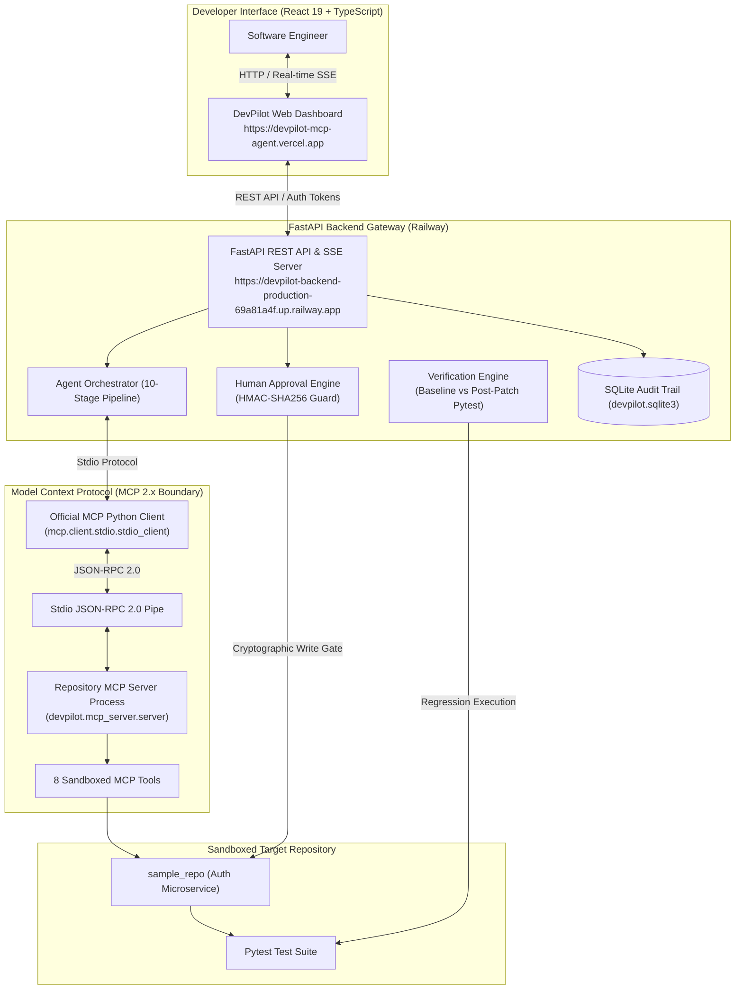

# DevPilot 🚀

> **Production-Style AI Software Engineering Agent with Model Context Protocol (MCP) & Cryptographic Human Governance**  
> *Autonomous codebase investigation, test failure diagnosis, human-authorized patching, and regression verification.*

[](https://www.python.org/downloads/)
[](https://modelcontextprotocol.io/)
[](https://fastapi.tiangolo.com)
[](https://react.dev)
[](docs/PORTFOLIO.md)
[](https://devpilot-mcp-agent.vercel.app)
[](https://devpilot-backend-production-69a81a4f.up.railway.app)
[](LICENSE)

---

## 1. Problem Statement & Overview

Modern AI coding assistants often act as unconstrained code generators or simulate tool usage through fragile function-calling dictionaries. In production environments:
1. **Unconstrained Execution is High-Risk:** Giving an LLM open-ended shell access (`bash -c`) creates severe security vulnerabilities, data loss risks, and prompt-injection hazards.
2. **Hallucination Without Verification:** A patch generated by an LLM is frequently assumed to be correct without running automated regression tests, introducing subtle bugs.
3. **Lack of Protocol Standardization:** Without an open standard, integrating AI tools with diverse repositories and execution environments is fragmented and non-portable.

**DevPilot** addresses these challenges by implementing an autonomous AI software engineering agent built on the **Official Model Context Protocol (MCP 2.x)** and **Google Gemini Developer API**. DevPilot inspects repositories, runs tests, isolates root causes, synthesizes unified diffs, halts for explicit human approval via cryptographic authorization tokens, and validates solutions through its automated verification engine.

- **Live Application (Vercel):** [https://devpilot-mcp-agent.vercel.app](https://devpilot-mcp-agent.vercel.app)
- **Live Backend API (Railway):** [https://devpilot-backend-production-69a81a4f.up.railway.app](https://devpilot-backend-production-69a81a4f.up.railway.app)
- **API Health Endpoint:** [https://devpilot-backend-production-69a81a4f.up.railway.app/api/health](https://devpilot-backend-production-69a81a4f.up.railway.app/api/health)
- **GitHub Repository:** [https://github.com/AdvythVaman05/devpilot-mcp-agent](https://github.com/AdvythVaman05/devpilot-mcp-agent)

---

## 2. Key Capabilities & Differentiators

- 🔌 **Genuine Model Context Protocol (MCP 2.x):** Uses the official Python `mcp` SDK to spawn an isolated repository MCP server over `stdio` transport. No simulated tool calls.
- 🛠️ **8 Sandboxed Repository Tools:** Strictly constrained to the repository root for code reading, searching, test execution, git queries, and patch proposals.
- 🛡️ **Backend-Enforced Human Approval Gate:** Write operations cannot bypass human oversight. Proposing a patch issues an HMAC-SHA256 token and transitions the session to `AWAITING_APPROVAL`. The agent **cannot** modify code until the user submits the matching token.
- 🧪 **Closed-Loop Verification Engine:** Enforces the invariant: *A synthesized diff is not a verified fix.* Captures baseline test failures and post-patch outcomes, ensuring zero regressions.
- 📡 **Real-Time SSE Observability:** Streams execution events, agent thoughts, tool parameter payloads, and stage durations directly to the browser via Server-Sent Events (`/api/sessions/{id}/stream`).
- 🔒 **Defense-in-Depth Security:** Directory traversal prevention (`commonpath` checks), command allowlisting, subprocess execution timeouts, and sensitive data redaction.
- ⚡ **Dual Provider Architecture:** Includes a deterministic **Demo Mode** for offline evaluation and 100% test suite reliability without API keys, alongside a **Live Gemini Mode** (`gemini-2.5-flash`).

---

## 3. Architecture & System Flow



---

## 4. Agent Orchestration Lifecycle (10 Stages)

DevPilot structures autonomous investigations into a deterministic, event-driven 10-stage lifecycle:

1. **Stage 1 — Initializing agent and provider:** Validates configuration, provider mode, and credentials.
2. **Stage 2 — Connecting to the MCP server:** Launches the MCP server as a subprocess and performs protocol handshake over `stdio`.
3. **Stage 3 — Discovering available tools:** Introspects registered MCP tools and their schemas via `session.list_tools()`.
4. **Stage 4 — Running baseline tests:** Executes Pytest to establish initial failure status, capturing failing test node IDs and tracebacks.
5. **Stage 5 — Inspecting repository files and failing tests:** Explores repository topology, searches symbols (`search_code`), and reads source ranges (`read_file`).
6. **Stage 6 — Identifying the root cause:** Analyzes failure traces against code logic to diagnose the underlying bug.
7. **Stage 7 — Preparing a proposed patch:** Synthesizes a minimal unified diff and calls `propose_patch` to generate a cryptographic token.
8. **Stage 8 — Waiting for human approval:** **Execution halts.** The write guard blocks any filesystem modifications until the user confirms the token.
9. **Stage 9 — Applying the approved patch:** The backend `ApprovalEngine` validates the token in constant time and applies the diff.
10. **Stage 10 — Running post-patch verification:** Executes Pytest post-patch, confirms the failing assertion passes, verifies zero regressions, and compiles the final report.

---

## 5. Model Context Protocol (MCP) Tools

The MCP server exposes 8 typed tools defined with Pydantic input models:

| Tool | Parameters | Description |
| :--- | :--- | :--- |
| `inspect_repository` | `repo_path: Optional[str]` | Analyzes repository topology, top-level directory structure, detected languages, and README overview. |
| `list_files` | `directory: str = "."`, `pattern: str = "*"`, `max_depth: int = 5` | Lists files matching a glob pattern, automatically excluding `.git`, `__pycache__`, `.venv`, and `node_modules`. |
| `read_file` | `file_path: str`, `start_line: Optional[int]`, `end_line: Optional[int]` | Reads line ranges with 1-indexed line numbers. Enforces a 500 KB maximum read limit. |
| `search_code` | `query: str`, `file_pattern: str = "*.py"`, `max_matches: int = 20`, `is_regex: bool = False` | Performs case-sensitive substring or regex searches across code files. |
| `run_tests` | `command: str = "pytest -v"`, `test_path: Optional[str] = None` | Executes allowlisted test commands with a 20-second timeout. Captures exit code, duration, passed/failed counts, and output. |
| `get_git_status` | *None* | Queries working tree status (`git status --porcelain`) for modified or untracked files. |
| `get_git_diff` | `cached: bool = False` | Generates a unified git diff of working tree changes. |
| `propose_patch` | `target_file: str`, `diff: str`, `rationale: str` | Creates a proposed patch record with a 64-character SHA-256 HMAC approval token. **Does not write to disk.** |

---

## 6. Provider Modes: Demo vs Live Gemini

DevPilot clearly distinguishes between its two operational modes:

| Feature | Demo Mode (Default) | Live Gemini Mode |
| :--- | :--- | :--- |
| **API Key Required** | No | Yes (`GEMINI_API_KEY`) |
| **Reasoning Provider** | Deterministic Mock Provider (`mock_provider.py`) | Google Gemini (`gemini-2.5-flash`) via `google-genai` SDK |
| **MCP Tool Calls** | **Genuine MCP Stdio Subprocess** | **Genuine MCP Stdio Subprocess** |
| **Pytest Execution** | **Real Local Subprocess** | **Real Local Subprocess** |
| **Reasoning Label** | Explicitly labeled `[SIMULATED REASONING - DEMO MODE]` | Live Gemini Model Thinking |
| **Verification Gate** | Enforced (Cryptographic Token + Pytest) | Enforced (Cryptographic Token + Pytest) |
| **Tested Status** | **Fully Tested & Verified** | **Architecture Implemented; Untested (No Key Supplied)** |

> [!NOTE]
> Demo Mode was explicitly built to demonstrate authentic, protocol-pure MCP tool invocation and test verification without requiring third-party API keys or incurring LLM usage costs.

---

## 7. Security Architecture & Controls

- **Filesystem Boundary:** All file access is validated via `os.path.commonpath`. Directory traversal attempts (`../../`) trigger a `SecurityViolationError`.
- **Command Allowlist:** The test runner strictly allows only `pytest` and `python -m pytest`. Shell chaining operators (`&&`, `||`, `;`, `|`, `$()`) are blocked.
- **Constant-Time Verification:** Approval tokens are compared using `hmac.compare_digest()` to eliminate timing-attack vulnerabilities.
- **Execution Timeouts:** All subprocess calls have a hard 20-second timeout to prevent resource exhaustion.
- **Secret Redaction:** API keys and sensitive tokens are filtered from SQLite audit tables and client-facing API responses.

---

## 8. Technology Stack

- **Backend:** Python 3.11+, FastAPI 0.115+, Uvicorn, Pydantic v2, SSE-Starlette
- **Protocol:** Official Model Context Protocol SDK (`mcp==2.3.0`)
- **AI Integration:** Google GenAI Python SDK (`google-genai==3.1.0`), Gemini 2.5 Flash
- **Testing:** Pytest 9.2+, Pytest-Asyncio
- **Database:** SQLite 3 (WAL mode)
- **Frontend:** React 19, TypeScript, Vite 8, Tailwind CSS, Lucide Icons
- **Deployment:** Railway (Docker containerized backend), Vercel (Edge static frontend)

---

## 9. Local Installation & Setup

### 1. Clone the Repository
```bash
git clone https://github.com/AdvythVaman05/devpilot-mcp-agent.git
cd devpilot-mcp-agent
```

### 2. Set Up Python Virtual Environment
```bash
python -m venv .venv
# On Windows:
.venv\Scripts\activate
# On Linux/macOS:
source .venv/bin/activate

pip install -r requirements.txt
cp .env.example .env
```

### 3. Launch the Backend Server
```bash
python -m devpilot.main --host 127.0.0.1 --port 8000
```
- API Docs: `http://127.0.0.1:8000/docs`
- Health Endpoint: `http://127.0.0.1:8000/api/health`

### 4. Launch the Frontend
In a separate terminal:
```bash
cd frontend
npm install
npm run dev
```
Open `http://localhost:5173` in your browser.

---

## 10. Automated Testing

DevPilot includes 39 unit, integration, and security tests:

```bash
# Execute full test suite
pytest tests/ -v
```

```text
============================= test session starts =============================
collected 39 items

tests/test_agent_orchestrator.py (2 tests) .......... PASSED
tests/test_api.py (5 tests) ......................... PASSED
tests/test_approval_system.py (3 tests) ............. PASSED
tests/test_e2e_workflow.py (1 test) ................. PASSED
tests/test_mcp_client.py (2 tests) .................. PASSED
tests/test_mcp_server.py (11 tests) ................. PASSED
tests/test_provider_modes.py (6 tests) .............. PASSED
tests/test_security.py (7 tests) .................... PASSED
tests/test_verification_engine.py (2 tests) ......... PASSED

============================= 39 passed in 14.31s =============================
```

To run the end-to-end multi-turn investigation script against any running backend:
```bash
# Test against local backend:
python test_e2e_backend.py http://127.0.0.1:8000/api

# Test against live Railway production backend:
python test_e2e_backend.py https://devpilot-backend-production-69a81a4f.up.railway.app/api
```

---

## 11. Production Deployment

### Railway (Backend)
- Uses a single-stage `Dockerfile` (Python 3.11-slim) with Git and Pytest pre-installed.
- Dynamically binds `$PORT` assigned by Railway (`0.0.0.0:${PORT:-8000}`).
- Managed via Railway CLI:
  ```bash
  railway up -s devpilot-backend -y
  railway domain --service devpilot-backend
  ```

### Vercel (Frontend)
- Built with Vite and configured via `VITE_API_BASE_URL`.
- Managed via Vercel CLI:
  ```bash
  cd frontend
  npm run build
  vercel deploy --prod --yes --non-interactive
  vercel alias set <deployment-url> devpilot-mcp-agent.vercel.app
  ```

---

## 12. In-Depth Documentation Links

- [System Architecture Specification](docs/ARCHITECTURE.md)
- [MCP Design & Protocol Details](docs/MCP_DESIGN.md)
- [Agent Orchestration Lifecycle](docs/AGENT_WORKFLOW.md)
- [Security Architecture & Governance](docs/SECURITY.md)
- [Production Deployment Guide](docs/DEPLOYMENT.md)
- [Recruiter Portfolio & Engineering Case Study](docs/PORTFOLIO.md)

---

## 13. License

Distributed under the [MIT License](LICENSE).
