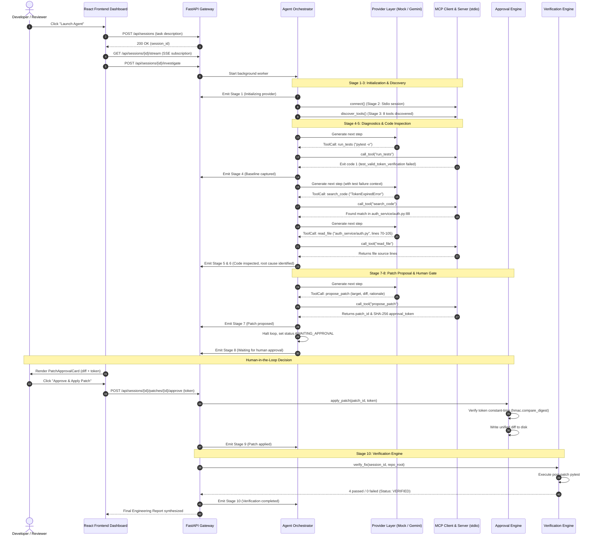

# Agent Orchestration & Lifecycle Workflow

## 1. Overview

DevPilot organizes autonomous software engineering investigations into a structured, observable, and verifiable **10-Stage Pipeline**. Rather than treating the agent as an opaque black box that returns an unchecked code blob, DevPilot emits real-time events for every stage transition, thought process, and tool invocation.

---

## 2. The 10-Stage Investigation Pipeline

| Stage # | Stage Name | Description | Evidence Captured |
| :--- | :--- | :--- | :--- |
| **Stage 1** | **Initializing agent and provider** | Validates runtime configuration, checks API key requirements, and instantiates the provider (Demo Mock vs Live Gemini). | Provider identification, latency, and credential validation status. |
| **Stage 2** | **Connecting to the MCP server** | Launches the MCP server as an isolated stdio subprocess and completes the protocol handshake. | Subprocess PID, protocol version (`2.x`), and transport confirmation. |
| **Stage 3** | **Discovering available tools** | Introspects registered MCP tools and their input schemas via `session.list_tools()`. | List of discovered tools (8 tools) and parameter schemas. |
| **Stage 4** | **Running baseline tests** | Executes the repository test suite via `run_tests` to establish the baseline failure state. | Exit code (e.g., 1), failing test node IDs, and error tracebacks. |
| **Stage 5** | **Inspecting repository files and failing tests** | Uses `inspect_repository`, `search_code`, and `read_file` to locate the failure origin. | File paths, line numbers, and relevant code excerpts. |
| **Stage 6** | **Identifying the root cause** | Analyzes the inspected code against failing assertions to isolate the exact defect. | Root cause diagnosis statement (e.g., inverted comparison operator). |
| **Stage 7** | **Preparing a proposed patch** | Synthesizes a minimal unified diff and calls `propose_patch` to generate a cryptographic approval token. | Patch ID, target file, unified diff preview, and SHA-256 token. |
| **Stage 8** | **Waiting for human approval** | **Execution is halted.** The backend write guard blocks any filesystem modifications until the user confirms the token. | `AWAITING_APPROVAL` status banner and token verification challenge. |
| **Stage 9** | **Applying the approved patch** | The backend `ApprovalEngine` validates the token and applies the patch directly to the target file. | Timestamp of approval, applied file path, and byte write confirmation. |
| **Stage 10** | **Running post-patch verification** | The `VerificationEngine` re-runs Pytest to confirm the failing test is resolved and zero regressions occurred. | Exit code (0), passing test counts (4/4), and `VERIFIED` report status. |

---

## 3. End-to-End Execution Sequence Diagram

---

## 4. Real-Time Observability (Server-Sent Events)

DevPilot implements real-time event streaming via `GET /api/sessions/{session_id}/stream`:

1. **`snapshot` Event:** Sent immediately upon connection. Contains the current state of the session, stages, events, tool calls, patches, test runs, and reports.
2. **`stage_update` Event:** Fired whenever one of the 10 stages transitions (`running`, `completed`, `failed`). Includes stage durations and evidence strings.
3. **`execution_event` Event:** Chronological log entries categorized as `AGENT`, `MCP`, `TOOL`, `TEST`, `APPROVAL`, or `ERROR`.
4. **`agent_thought` Event:** Broadcasts the model's reasoning text. Explicitly flags whether the reasoning is simulated (`is_simulated: true`) or live.
5. **`tool_invoking` & `tool_result` Events:** Streams tool parameter payloads and execution results as they happen.

A client polling fallback is built into the dashboard (`pollSession`) to ensure updates continue even if the SSE connection drops or is interrupted by intermediate proxies.

---

## 5. Engineering Report Synthesis

When an investigation reaches verified completion, DevPilot generates a structured Markdown report stored in the `reports` table:
- **Executive Summary:** High-level problem statement and resolution status.
- **Root Cause Analysis:** Technical diagnosis of the failure mechanism.
- **Tool Invocations Audit:** Table of all MCP tools executed, their status, and durations.
- **Patch Details:** Unified diff applied and cryptographic token hash.
- **Verification Evidence:** Baseline vs post-patch Pytest metrics confirming zero regressions.
