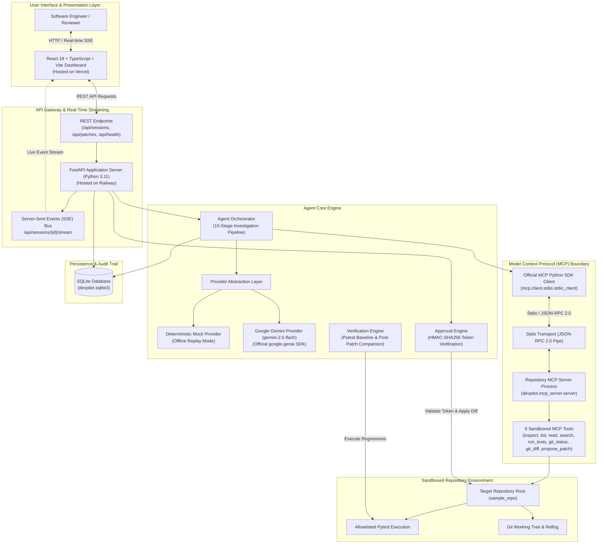

# DevPilot — System Architecture Specification

## 1. Executive Overview

**DevPilot** is an autonomous, production-style software engineering agent designed to investigate codebases, diagnose test failures, isolate root causes, propose minimal unified diffs, halt for explicit human approval via cryptographic authorization tokens, and verify fixes through automated regression testing.

Unlike conventional LLM wrappers that execute arbitrary shell commands or simulate tool usage through in-memory dictionaries, DevPilot is built on the **Official Model Context Protocol (MCP 2.x)** standard. It communicates with an isolated repository MCP server over `stdio` transport, ensuring strict sandboxing, defense-in-depth security, and execution observability.

---

## 2. High-Level Architecture Diagram

---

## 3. Component Architecture & Responsibilities

### 3.1 Frontend Developer Dashboard (React 19 + TypeScript + Vite)
- **Deployment:** Vercel (`https://devpilot-mcp-agent.vercel.app`).
- **Responsibilities:**
  - **10-Stage Pipeline Visualization:** Displays stage status (`pending`, `running`, `completed`, `failed`), execution durations, explanations, and expandable evidence drawers.
  - **Live Execution Trace:** Filterable chronological stream of system events (Agent thoughts, MCP tool calls, Pytest runs, Approval halts) delivered via Server-Sent Events (SSE).
  - **Human Governance Card:** Renders unified syntax-highlighted diffs, rationale, and target files. Requires human authorization before write actions.
  - **Verification Results Card:** Displays comparative metrics: baseline failures, fixed assertions, regressions, and total passing tests.
  - **Zero-Silent-Fallback Enforcement:** Displays an explicit connection alert if the backend is offline, requiring the user to intentionally choose between backend retry or offline preview simulation.

### 3.2 API Gateway (FastAPI)
- **Deployment:** Railway (`https://devpilot-backend-production-69a81a4f.up.railway.app`).
- **Responsibilities:**
  - **REST API:** Handles repository enumeration, session management, investigation initiation, patch approval/rejection, runtime configuration, and health monitoring.
  - **Server-Sent Events (SSE):** Manages per-session in-memory pub/sub event queues (`broadcast_event`), streaming real-time stage updates and execution trace events to active clients.
  - **CORS Protection:** Configured with strict allowlists for local development (`localhost:5173`, `127.0.0.1:5173`) and production domains (`https://devpilot-mcp-agent.vercel.app` and `https://.*\.vercel\.app`).

### 3.3 Agent Orchestrator (`devpilot.agent.orchestrator`)
- **Responsibilities:**
  - Coordinates the multi-turn agent investigation loop across 10 deterministic stages.
  - Translates user directives into investigation plans.
  - Dispatches MCP tool calls to the official MCP client.
  - Evaluates tool responses and updates investigation stages with real-time duration and evidence.
  - Halts execution at Stage 8 when a patch is proposed, updating session state to `AWAITING_APPROVAL`.
  - Synthesizes the final structured Engineering Report in Markdown upon verified resolution.

### 3.4 Provider Abstraction Layer
- **Demo Mode (Deterministic Mock Provider):**
  - Simulates multi-turn reasoning steps for investigating the sample authentication service.
  - Faithfully issues function calls for genuine MCP tools (`inspect_repository`, `run_tests`, `search_code`, `read_file`, `propose_patch`).
  - Enables 100% offline development, automated testing, and zero-credential demonstration.
  - Clearly labels all thoughts with `[SIMULATED REASONING - DEMO MODE]`.
- **Live Gemini Mode (Google Gemini API):**
  - Uses the official `google-genai` Python SDK (`v3.1.0`) with model `gemini-2.5-flash`.
  - Dynamically builds `types.FunctionDeclaration` objects by introspecting registered MCP tool JSON schemas.
  - Enforces strict credential checks: Refuses to execute without `GEMINI_API_KEY`.

### 3.5 Model Context Protocol (MCP) Client & Server
- **MCP Client (`devpilot.mcp_client.client`):**
  - Implements the official MCP Python SDK (`mcp==2.3.0`).
  - Spawns the MCP server as an isolated subprocess using `mcp.client.stdio.stdio_client`.
  - Establishes a JSON-RPC 2.0 handshake (`session.initialize()`).
  - Discovers tools dynamically via `session.list_tools()`.
  - Dispatches tool invocations and records execution metadata (duration, arguments, return payload).
- **Repository MCP Server (`devpilot.mcp_server.server`):**
  - An independent process exposing 8 sandboxed repository tools.
  - Operates strictly within the configured repository root.

### 3.6 Human Approval Engine (`devpilot.approval.engine`)
- **Responsibilities:**
  - Implements the backend-enforced write guard.
  - Generates a 64-character SHA-256 HMAC cryptographic token upon patch proposal.
  - Halts all automated execution; refuses any file write until `POST /api/sessions/{id}/patches/{id}/approve` receives the matching token.
  - Verifies tokens using constant-time comparison (`hmac.compare_digest`) to protect against timing attacks.
  - Validates target file boundaries to prevent directory traversal before writing.

### 3.7 Verification & Regression Engine (`devpilot.verification.engine`)
- **Responsibilities:**
  - Executes allowlisted test commands before and after patch application.
  - Parses structured Pytest outcomes: passed, failed, skipped, error messages, failing test node IDs.
  - Compares post-patch test results against baseline test runs to identify:
    - `fixed_tests`: Tests that failed at baseline but passed after patch.
    - `regressions`: Tests that passed at baseline but failed after patch.
  - Assigns conclusive verification status: `VERIFIED` or `FAILED`.

### 3.8 Persistence & Audit Trail (SQLite)
- **Database:** `devpilot.sqlite3` managed via [`devpilot.db.database.DatabaseManager`](file:///c:/Projects/DevPilot/devpilot/db/database.py).
- **Schema:**
  - `sessions`: Session ID, status, repository path, task description, timestamps.
  - `plans`: Multi-step investigation plans with per-step completion status.
  - `session_stages`: 10-stage execution pipeline records with durations, explanations, and evidence.
  - `execution_events`: Chronological execution trace events with category, detail, and JSON payloads.
  - `tool_calls`: Audit log of all MCP tool invocations with arguments, status, duration, and output.
  - `patches`: Proposed patches, target files, diffs, rationales, approval tokens, and approval status.
  - `test_runs`: Baseline and verification Pytest runs with exit codes, counts, and raw terminal output.
  - `reports`: Final synthesized engineering reports with root causes and verification outcomes.

---

## 4. Security Architecture

1. **Path Traversal Defense:** All file paths are validated against the repository root using `os.path.commonpath`. Attempts to escape the repository root raise `SecurityViolationError`.
2. **Command Allowlisting:** The `run_tests` tool strictly allows only `pytest` and `python -m pytest` with allowlisted arguments. Shell chaining operators (`&&`, `||`, `;`, `|`, `$()`) are blocked.
3. **Execution Timeouts:** Subprocess executions are wrapped with strict timeouts (`COMMAND_TIMEOUT_SECONDS = 20`) to prevent resource exhaustion.
4. **Credential Isolation:** API keys are never stored in SQLite, never logged to stdout, and never returned in client-facing API responses.
5. **Write-Guard Invariant:** The MCP server process has **read-only** tools for code inspection. The only tool that prepares code changes (`propose_patch`) creates a database record; the actual file write is performed exclusively by the backend `ApprovalEngine` after cryptographic token verification.
