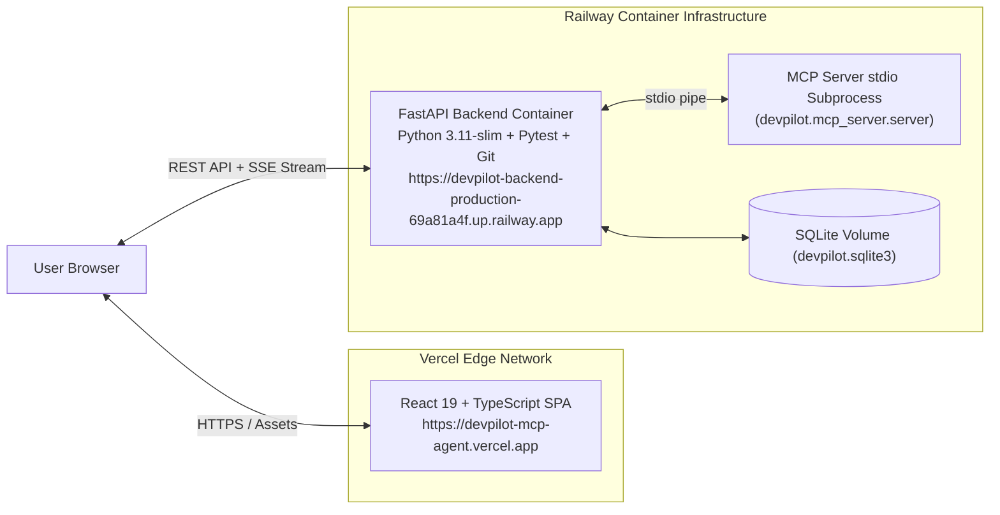

# Production Deployment & Local Setup Guide

## 1. Production Architecture Overview

DevPilot is deployed as a distributed, decoupled system:



| Component | Host / Platform | Production URL | Configuration |
| :--- | :--- | :--- | :--- |
| **Frontend Dashboard** | **Vercel** | [https://devpilot-mcp-agent.vercel.app](https://devpilot-mcp-agent.vercel.app) | React 19, TypeScript, Vite, Tailwind CSS. Production env var: `VITE_API_BASE_URL`. |
| **FastAPI Backend** | **Railway** | [https://devpilot-backend-production-69a81a4f.up.railway.app](https://devpilot-backend-production-69a81a4f.up.railway.app) | Python 3.11-slim Docker container, dynamic `$PORT` binding, stdio MCP server. |

---

## 2. Deploying the Backend to Railway

### Prerequisites:
- Railway CLI (`railway --version >= 5.60.0`)
- Authenticated Railway account (`railway login`)

### Step-by-Step Deployment:

1. **Initialize or Link Railway Project:**
   ```bash
   railway init --name DevPilot
   ```
2. **Create the Backend Service:**
   ```bash
   railway add --service devpilot-backend
   railway service link devpilot-backend
   ```
3. **Configure Environment Variables:**
   ```bash
   railway variable set PROVIDER_MODE=demo --skip-deploys
   ```
4. **Deploy via Dockerfile:**
   ```bash
   railway up -s devpilot-backend -y
   ```
5. **Generate a Public Domain:**
   ```bash
   railway domain --service devpilot-backend
   ```
6. **Verify Health Endpoint:**
   ```bash
   curl -s https://devpilot-backend-production-69a81a4f.up.railway.app/api/health
   ```
   Expected response:
   ```json
   {
     "status": "ok",
     "app_name": "DevPilot",
     "version": "1.0.0",
     "provider_mode": "demo",
     "mcp_server_status": "ready",
     "protocol": "Model Context Protocol (MCP) 2.x"
   }
   ```

---

## 3. Deploying the Frontend to Vercel

### Prerequisites:
- Vercel CLI (`npm install -g vercel`)
- Node.js 20+

### Step-by-Step Deployment:

1. **Set Production API URL Environment Variable:**
   ```bash
   cd frontend
   echo "https://devpilot-backend-production-69a81a4f.up.railway.app" | vercel env add VITE_API_BASE_URL production
   ```
2. **Build and Deploy to Production:**
   ```bash
   npm run build
   vercel deploy --prod --yes --non-interactive
   ```
3. **Assign Custom Alias:**
   ```bash
   vercel alias set <deployment-url> devpilot-mcp-agent.vercel.app
   ```
4. **Ensure Public Accessibility:**
   Disable Vercel Deployment Protection (SSO) so reviewers can test without login:
   ```bash
   vercel project protection disable frontend --sso
   ```

---

## 4. Local Installation & Development

### 1. Clone Repository
```bash
git clone https://github.com/AdvythVaman05/devpilot-mcp-agent.git
cd devpilot-mcp-agent
```

### 2. Configure Backend Environment
Create a virtual environment with Python 3.11+:
```bash
python -m venv .venv
# Windows:
.venv\Scripts\activate
# Linux/macOS:
source .venv/bin/activate

pip install -r requirements.txt
cp .env.example .env
```

### 3. Launch the Backend Server
```bash
python -m devpilot.main --host 127.0.0.1 --port 8000
```
- API Docs: `http://127.0.0.1:8000/docs`
- Health check: `http://127.0.0.1:8000/api/health`

### 4. Launch the Frontend Development Server
In a separate terminal:
```bash
cd frontend
npm install
npm run dev
```
Open `http://localhost:5173` in your browser.

---

## 5. Running the Automated Test Suite

DevPilot includes a comprehensive test suite covering the MCP server, MCP client, agent orchestrator, approval engine, verification engine, and security boundaries.

```bash
# Run all 39 tests with verbose output
pytest tests/ -v
```

All 39 tests pass offline in Demo Mode without requiring external API keys.

---

## 6. Configuring Google Gemini for Live Mode

When ready to use Live Google Gemini API:
1. Obtain an API key from [Google AI Studio](https://aistudio.google.com/).
2. Set it on Railway:
   ```bash
   railway variable set GEMINI_API_KEY="your-api-key"
   ```
   Or in your local `.env`:
   ```ini
   PROVIDER_MODE=live
   GEMINI_API_KEY=your-api-key
   GEMINI_MODEL=gemini-2.5-flash
   ```
3. Test connectivity in the dashboard's **Settings Modal** or via `POST /api/config/test-gemini`.
