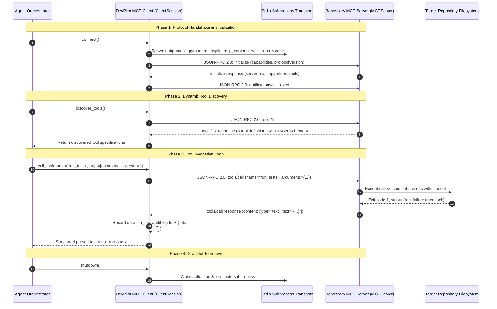

# Model Context Protocol (MCP) Design & Implementation

## 1. Overview & Protocol Fundamentals

The **Model Context Protocol (MCP)** is an open standard designed by Anthropic and the open-source AI community to safely connect Large Language Models with external tools, contextual data sources, and runtime environments.

Rather than implementing ad-hoc, proprietary function-calling wrappers that vary across LLM providers, DevPilot uses the **Official Model Context Protocol Python SDK (`mcp==2.3.0`)**. This decouples the agent orchestration logic from the underlying repository tools, enforcing strict process isolation and protocol-level standardization.

---

## 2. Protocol Architecture & Request/Response Flow

DevPilot runs the repository MCP server as an independent, sandboxed subprocess. Communication occurs over standard input and standard output (`stdio`) using JSON-RPC 2.0 framing.



---

## 3. MCP Client Implementation (`devpilot.mcp_client.client`)

The MCP client is implemented in [`devpilot/mcp_client/client.py`](file:///c:/Projects/DevPilot/devpilot/mcp_client/client.py) using the official `mcp.client.stdio.stdio_client` and `mcp.ClientSession`.

### Key Responsibilities:
1. **Subprocess Lifecycle Management:**
   - Launches `python -m devpilot.mcp_server.server --repo <repo_root> --session-id <session_id>` using `StdioServerParameters`.
   - Manages asynchronous process context, preventing orphaned processes.
2. **Session Initialization:**
   - Performs protocol negotiation via `session.initialize()`.
   - Discovers registered tools via `session.list_tools()`.
3. **Structured Tool Calling:**
   - Invokes tools via `session.call_tool(tool_name, arguments)`.
   - Parses the returned `CallToolResult` text blocks into native Python dictionaries.
4. **Audit Trail & Latency Tracking:**
   - Measures execution time in milliseconds (`duration_ms`).
   - Redacts sensitive patterns in tool arguments before logging.
   - Persists all invocations into the `tool_calls` table in `devpilot.sqlite3`.

---

## 4. Repository MCP Server (`devpilot.mcp_server.server`)

The server is built with the official SDK's `MCPServer` class and exposes 8 repository tools. Every tool is strictly constrained to the repository root.

### The 8 Registered MCP Tools:

| # | Tool Name | Parameters | Description & Security Boundary |
| :- | :--- | :--- | :--- |
| **1** | `inspect_repository` | `repo_path: Optional[str]` | Analyzes repository topology, top-level directory structure, detected languages, and README overview. Safe read-only inspection. |
| **2** | `list_files` | `directory: str = "."`, `pattern: str = "*"`, `max_depth: int = 5` | Recursively enumerates files matching a glob pattern. Automatically excludes `.git`, `__pycache__`, `.venv`, and `node_modules`. |
| **3** | `read_file` | `file_path: str`, `start_line: Optional[int]`, `end_line: Optional[int]` | Reads specific line ranges or whole files with 1-indexed numbering. Enforces a 500 KB maximum read limit to prevent memory bloat. |
| **4** | `search_code` | `query: str`, `file_pattern: str = "*.py"`, `max_matches: int = 20`, `is_regex: bool = False` | Performs case-sensitive substring or regex searches across repository files. Returns matched file paths, line numbers, and line contents. |
| **5** | `run_tests` | `command: str = "pytest -v"`, `test_path: Optional[str] = None` | Sandboxed test execution. Validates command against strict allowlist (`pytest`, `python -m pytest`). Rejects shell chaining operators (`&&`, `\|\|`, `;`, `\|`). Enforces 20-second timeout. Parses exit codes, passing/failing test names, and terminal output. |
| **6** | `get_git_status` | *None* | Runs `git status --porcelain` to report dirty state, modified files, and untracked files in the sandboxed repository. |
| **7** | `get_git_diff` | `cached: bool = False` | Generates unified git diff of working tree changes using `git diff`. |
| **8** | `propose_patch` | `target_file: str`, `diff: str`, `rationale: str` | Synthesizes a unified diff proposal and generates a 64-character SHA-256 HMAC cryptographic token. **Does not write to disk.** Sets patch status to `PENDING_APPROVAL`. |

---

## 5. Schema Normalization for Gemini Function Calling

Google Gemini's Function Calling API expects strict JSON Schemas without specific draft-specific metadata keys (such as `title`, `$defs`, `additionalProperties` in some nesting levels, or custom extensions).

DevPilot implements an automated schema cleaner in [`devpilot.agent.orchestrator._clean_schema_for_gemini`](file:///c:/Projects/DevPilot/devpilot/agent/orchestrator.py#L40-L75):
- Strips unsupported schema properties (`title`, `default`, `description` on non-primitive nodes).
- Recursively cleans `properties` and array `items`.
- Translates MCP tool definitions into compliant `google.genai.types.FunctionDeclaration` objects.

---

## 6. Real-World Execution Evidence

During acceptance testing on the production Railway backend (`https://devpilot-backend-production-69a81a4f.up.railway.app`), the MCP Client discovered all 8 registered tools and executed 5 distinct tools in sequence:

```text
1. inspect_repository (224ms) -> Discovered auth microservice topology
2. run_tests          (756ms) -> Pytest captured baseline failure (test_valid_token_verification)
3. search_code        (3ms)   -> Found TokenExpiredError in auth_service/auth.py
4. read_file          (2ms)   -> Inspected token expiration logic (lines 70-105)
5. propose_patch      (14ms)  -> Generated unified diff & SHA-256 approval token
```
