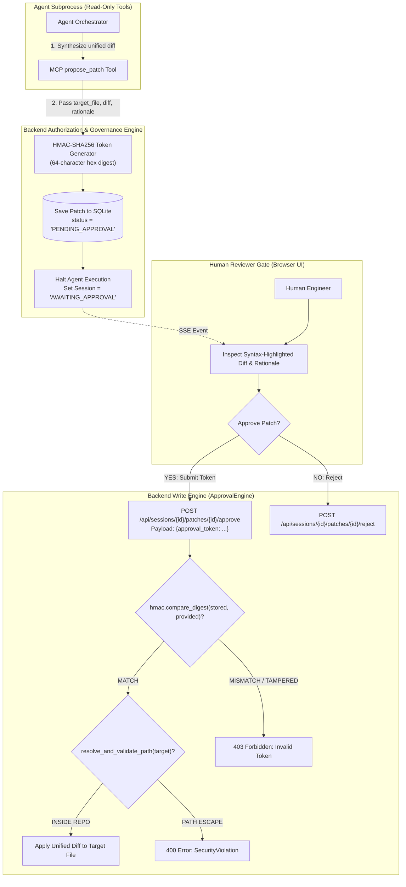

# Security Architecture & Governance Model

## 1. Security Philosophy

Autonomous coding agents present unique security risks. If given unrestricted shell or filesystem access, an agent can unintentionally corrupt system files, delete production data, leak sensitive credentials, or be tricked by prompt injections into downloading malicious dependencies.

DevPilot enforces a **Zero Unconstrained Execution** policy through a defense-in-depth architecture:

1. **Strict Filesystem Sandboxing:** Access is locked to an explicitly configured repository root.
2. **Command Allowlisting:** Arbitrary bash/cmd execution is prohibited; only fixed, vetted commands can be run.
3. **Write-Guarded Human Governance:** Source code cannot be modified without human review and cryptographic token verification.
4. **Credential Isolation:** API keys and credentials are never persisted to disk or sent over browser networks.

---

## 2. Human-in-the-Loop Approval & Write Guard

DevPilot enforces the critical invariant: **The agent may inspect code and propose changes, but it can never write to disk autonomously.**



### Key Governance Controls:
- **Cryptographic Token Binding:** Every patch proposal generates an HMAC-SHA256 token computed from the session ID, target file path, diff content, and a server-side secret.
- **Constant-Time Comparison:** The token is validated using Python's `hmac.compare_digest()` to eliminate timing attack vulnerabilities.
- **State Transition Guard:** Patches must be in status `PENDING_APPROVAL`. Once approved, status changes to `APPLIED`, preventing double-application or replay attacks.

---

## 3. Filesystem Sandboxing & Path Traversal Prevention

All file access operations (`read_file`, `search_code`, `list_files`, `inspect_repository`, and patch application) pass through a central path validation routine in [`devpilot.security.resolve_and_validate_path`](file:///c:/Projects/DevPilot/devpilot/security.py):

```python
def resolve_and_validate_path(target_path: Union[str, Path], base_dir: Path) -> Path:
    base_resolved = base_dir.resolve()
    target_resolved = (base_dir / target_path).resolve()
    
    # Ensure target_resolved starts with base_resolved
    try:
        common = Path(os.path.commonpath([base_resolved, target_resolved]))
    except ValueError:
        raise SecurityViolationError(f"Access denied: '{target_path}' is outside sandbox root.")
        
    if common != base_resolved:
        raise SecurityViolationError(f"Path traversal detected: '{target_path}' resolves outside sandbox.")
        
    return target_resolved
```

### Tested Defenses:
- `../` and `../../../../etc/passwd` directory traversal attempts are trapped and raise `SecurityViolationError`.
- Absolute paths pointing outside the repository root are rejected.
- Symbolic links resolving outside the repository root are trapped via `.resolve()`.

---

## 4. Subprocess Sandboxing & Command Allowlisting

The `run_tests` MCP tool executes terminal commands, making it a critical security boundary.

### Controls Enforced:
1. **Strict Command Allowlist:** Only `pytest` and `python -m pytest` commands are allowed.
2. **Operator Rejection:** Commands containing shell chaining or redirection operators (`&&`, `||`, `;`, `|`, `` ` ``, `$()`, `>`, `<`) are rejected before execution.
3. **Execution Timeouts:** Every test execution is wrapped with a 20-second timeout (`COMMAND_TIMEOUT_SECONDS = 20`). If a test hangs or executes an infinite loop, the subprocess is killed immediately.
4. **No Raw Shell:** Commands are parsed and executed using `subprocess.run(args, shell=False)` without shell interpolation.

---

## 5. Secret Protection & Redaction

1. **No Credentials in SQLite:** User tasks, tool calls, and execution traces are persisted, but sensitive strings matching regex patterns (API keys, JWT secrets, Bearer tokens) are redacted using [`devpilot.security.redact_sensitive_data`](file:///c:/Projects/DevPilot/devpilot/security.py).
2. **Safe Public APIs:**
   - `GET /api/health` reports only a boolean flag (`gemini_api_key_configured: true/false`).
   - `GET /api/config` never returns secret strings.
3. **Frontend Isolation:** The Google Gemini API key is never transmitted to frontend JavaScript or exposed in browser network responses.
